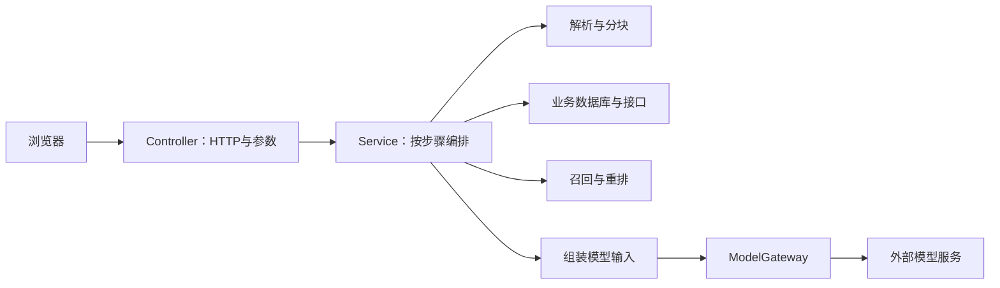

# Java 代码带读：从订单 123 到带证据的回答

> 面向能读 Java、第一次接触本项目的同事。以当前源码为准；业务日期固定为 2026-10-28，订单和政策均为教学数据。
> 建议先自己按第 2–5 节走读，再用文末 40 分钟提纲分享。无需先读完所有类。

## 1. 先认清三条链路

| 入口 | 主要编排类 | 数据来源 | 向量库 | 目标 |
|---|---|---|---|---|
| `/classic-tutorial.html` | `ClassicRagService` | 三份 Markdown，含订单快照 | Milvus 临时集合 | 看懂文档如何变成回答 |
| `/tutorial.html` | `OrderTutorialService` | 政策目录＋H2 订单＋模拟 HTTP 履约接口 | Milvus 临时集合 | 理解实时事实、适用范围和规则判断 |
| `/` | `RagService`、`IngestionWorker` | 用户上传文档 | Qdrant | 文档入库、混合检索、持续问答 |

**不要把它们讲成同一条调用链。** 正式知识库不会自动查询订单教学数据库；教学集合也不是正式知识库的集合。`/evaluation-tutorial.html` 的评测逻辑主要在前端，调用第二讲现有接口，并没有单独的 Java 评测引擎。

项目使用 Java 17、Spring Boot 4.1.1、Spring AI 2.0.1，版本见 [pom.xml](../java-chatbot/pom.xml)。`OpenAiChatModel` 是这里使用的兼容 API 客户端类名，实际供应商由配置决定。



读 Java 时只问四件事：这个方法收什么对象？调用谁？返回什么对象？失败后怎样处理？

## 2. 第一站：一次点击怎样进入 Java（约 5 分钟）

打开 [ClassicRagController.java](../java-chatbot/src/main/java/chatbot/chat/rag/tutorial/classic/ClassicRagController.java)，依次读 `Create`、`create()`、`execute()`、`owner()`。

- `@RestController` 将返回对象序列化为 HTTP 响应；本例主要是 JSON。
- `@RequestMapping` 定义路径前缀；`@PostMapping` 对应创建和执行动作。
- `record Create(...)` 是请求 DTO。`@Valid` 配合 `@NotBlank`、`@Size` 校验问题文本。
- 构造器注入 `ClassicRagService`：Controller 不负责建立向量库或调用模型。
- `owner()` 使用 HTTP Session ID 隔离实验；它不是企业员工身份认证。
- `@ConditionalOnProperty` 要求 `rag.tutorial.enabled=true`，否则教学 Controller/Service 不启用。

页面不是一次 HTTP 请求完成整个流程：

```text
POST /api/v1/tutorial/classic/runs                  → runId
POST /api/v1/tutorial/classic/runs/{runId}/documents → Trace
POST /api/v1/tutorial/classic/runs/{runId}/parse     → Trace
…
DELETE /api/v1/tutorial/classic/runs/{runId}         → 清理临时集合
```

**讲述话术：**“点按钮只负责发请求。真正的工作在 Service；返回值不仅包含结果，还包含这一步收到的数据和耗时，所以我们能逐步看清链路。”

建议断点：Controller 的 `execute()`；观察 `id`、`step`、Session，然后单步进入 Service。调试期间不要让其他人同时操作同一实验。

## 3. 第二站：经典 RAG 的十步（约 10 分钟）

打开 [ClassicRagService.java](../java-chatbot/src/main/java/chatbot/chat/rag/tutorial/classic/ClassicRagService.java)，先读 `STEPS`、`Run`、`Trace`，再读 `execute()` 的 switch。先把私有方法折叠，避免一开始陷入细节。

| 方法/分支 | 输入 → 输出 | 要讲清的意义 |
|---|---|---|
| `documents()` | 资源文件 → `List<Source>` | 企业证据来自原文，不在模型参数里 |
| `parse()` | 文档 → `ParsedSection` | 解析文件格式，保留可读文本 |
| `chunk()` | 章节 → `List<Piece>` | 一条检索结果是片段，不是整份文件 |
| `embed()` | 片段文本 → `List<float[]>` | 向量是检索表示，不能替代原文 |
| store 分支 | id、向量、来源、原文 → Milvus | 命中后必须能取回原文 |
| `question()` | 问题 → 向量 | 使用与文档相同的 Embedding 模型 |
| search 分支 | 问题向量 → 6 个候选 | 召回只是候选，不保证全部有用 |
| `rerank()` | 问题＋候选 → 排序后的最多 6 条 | 只能重排已有候选，不能找回漏召回内容 |
| `prompt()` | 问题＋证据 → system/user 消息 | 将找到的原文送给生成模型 |
| `answer()` | 消息 → 回答与来源列表 | 模型组织答案，仍需核对证据 |

`Run` 是单次实验的内存状态，包含集合名、问题、片段、向量和历史 Trace。重启后不保留实验；过期清理负责删除临时集合。`execute()` 校验步骤顺序及所属会话。经典实现的方法使用 `synchronized`，不能将它宣传为高并发生产编排。

### 3.1 看解析与分块，不把它们当模型能力

读 [DocumentParser.java](../java-chatbot/src/main/java/chatbot/chat/rag/ingest/DocumentParser.java) 的 `parse()`、`parseText()`，再读 [Chunker.java](../java-chatbot/src/main/java/chatbot/chat/rag/ingest/Chunker.java) 的 `split()`。

PDF 用 PDFBox，Word 用 POI，文本按 UTF-8 读取。当前 Markdown 处理识别 ATX 标题并分节，保留标题原文；它不是完整 Markdown 渲染器。扫描 PDF 没有 OCR。分块尽量找段落、换行或标点边界，避免跨章节；重叠保留上下文，但也会带来重复证据。

三种长度别混淆：经典教学 `220/40`，订单教学 `180/30`，通用默认 `800/120`。单位是字符窗口/重叠字符，不是 token。

### 3.2 看 Milvus 存了什么

读 [ClassicMilvus.java](../java-chatbot/src/main/java/chatbot/chat/rag/tutorial/classic/ClassicMilvus.java) 的 `store()`、`search()`，并回看 Service 的 `rows()`。

```text
一条存储记录 = id + vector + source + text
匹配靠 vector，回答靠 text，追溯靠 source/id。
```

这里通过 Java HTTP 客户端调用 Milvus REST v2。不要将它讲成 Spring AI 自动管理的 VectorStore。`vectorPreview()` 只显示前 8 维，实际检索使用完整向量。

### 3.3 看真正调用模型的位置

打开 [ModelGateway.java](../java-chatbot/src/main/java/chatbot/chat/rag/model/ModelGateway.java)：

```java
return embedding.embed(texts); // 文本变向量
var response = chat.call(prompt); // 消息变回答
```

以上为源码摘录，位于不同方法。教学生成走 `tutorialAnswer()` → `boundedAnswer()`，正式问答走 `answer()`；两者超时与重试设置不同。模型调用是有延迟、可能失败的外部请求。解析、分块、SQL、范围筛选和 RRF 都不是 LLM 在做。

**停下来问同事：**“如果订单快照没有召回，重排能把它补回来吗？”答案是不能。需要调整召回或证据组织策略，而不是只改回答提示词。

## 4. 第三站：第二讲为什么多了业务代码（约 12 分钟）

先看 [OrderData.java](../java-chatbot/src/main/java/chatbot/chat/rag/tutorial/order/OrderData.java)。这些 record 是流程中的数据契约：

```text
Intent：订单号、演示用户、问题、教学日期
Order：归属、地区、品类、购买日期
Fulfillment：签收日期、履约状态、是否已有售后
Policy：适用范围、有效期、returnDays、原文
Scope：允许检索的 policy ID 与排除原因
Eligibility：状态、签收天数、期限、理由、建议动作
```

接着打开 [OrderTutorialService.java](../java-chatbot/src/main/java/chatbot/chat/rag/tutorial/order/OrderTutorialService.java) 的 `execute()`，沿 C–L 阅读：

1. `question()` 用正则提取订单号；它不是 LLM 意图识别。演示用户来自服务端常量。
2. [DemoOrderRepository.findOwned()](../java-chatbot/src/main/java/chatbot/chat/rag/tutorial/order/DemoOrderRepository.java) 用 JDBC 参数化 SQL 同时匹配订单号与用户。999 属于另一个演示用户，查询被拒绝。这个 H2 内存库与正式文档元数据库独立。
3. [DemoFulfillmentClient.java](../java-chatbot/src/main/java/chatbot/chat/rag/tutorial/order/DemoFulfillmentClient.java) 通过真实 HTTP 获取模拟履约数据。HTTP 边界是真实的，订单状态是虚构的。
4. [OrderPolicies.scope()](../java-chatbot/src/main/java/chatbot/chat/rag/tutorial/order/OrderPolicies.java) 筛地区、品类、发布状态、购买日期。有效期是 `[from,to)`；并非一律取最新政策。
5. `keyword()` 只在适用片段上运行 Lucene BM25；`vector()` 将 documentId 范围下推到 Milvus，再取 Top 6。
6. `fusion()` 合并候选；`rerank()` 将融合候选进一步排为 Top 4。
7. `prompt()` 先执行业务规则，再把事实、规则结果与原文证据放入模型消息。
8. `answer()` 生成回答并检查引用编号。无充分依据分支直接返回说明，不调用生成模型。

### 4.1 真正值得停留的 SQL

源码中的固定 SQL：

```sql
SELECT id, customer_id, category, region, model, purchased_at
FROM demo_orders WHERE id = ? AND customer_id = ?
```

**话术：**“订单号来自提问，但当前用户来自服务端。两个条件一起查。这里不是让大模型生成 SQL，更不是知道订单号就可以查任意订单。”

### 4.2 购买日期与签收日期分工不同

读 `OrderPolicies.scope()` 与 `evaluate()` 时并排比较：购买日期决定政策版本；签收日期决定经过多少天。`returnDays` 是预先准备的结构化政策字段，期限并非由 LLM 临时阅读原文后抽取。

`evaluate()` 依次处理无政策、多政策、无证据、履约数据不匹配、已有售后、未签收、超期和期限内。订单 123 的预期规则结果是 `CONDITIONAL`：允许有条件申请，商品完好仍待确认。

**重要代码边界：**传入 `evaluate()` 的 `hasEvidence` 只判断候选非空，没有验证“申请条件＋操作步骤”是否全部覆盖。即使规则计算正确，检索仍可能漏掉解释所需条款。扩充语料后的失败例正好说明这一点。

### 4.3 这一步到底谁在判断？

```text
订单事实 + 结构化政策 → Java evaluate() → Eligibility
Eligibility + 检索原文 + 问题 → Prompt → 语言模型组织解释
```

模型输入要求不改写规则，但这只是约束提示，不是逐句事实验证。`citationNumbersValid` 只说明引用编号对应本轮证据；无法证明该原文支持该句话。

### 4.4 建库与在线问答分开读

A/B 是原文与建库准备。`prepare()` 将 5 份政策写成临时 Markdown，解析分块，每批最多 16 条调用 Embedding，然后入库。C–L 才是本次问题的处理链路。生产中不会每次提问都重建整个政策库。

第二讲重新执行上游时清除下游 Trace，防止旧结果与新输入混用。按 Run 加锁与全局请求槽控制演示并发；这仍不是正式任务队列或分布式工作流。

## 5. 第四站：召回、融合、重排到底有什么区别（约 5 分钟）

读 [TutorialFusion.java](../java-chatbot/src/main/java/chatbot/chat/rag/tutorial/TutorialFusion.java)、[ReciprocalRankFusion.java](../java-chatbot/src/main/java/chatbot/chat/rag/retrieval/ReciprocalRankFusion.java)、[Reranker.java](../java-chatbot/src/main/java/chatbot/chat/rag/retrieval/Reranker.java)。

- BM25：根据关键词匹配评分。
- 向量：根据语义表示的相似度取候选。
- RRF：根据各路名次累加 `1 / (60 + rank)`，按片段 ID 合并，不直接加 BM25 与向量分数。
- 重排：重新比较问题与候选全文；HTTP 模式读取候选 index 和 relevance_score，检查索引范围、重复索引及有限数值。LLM 模式只返回顺序，不伪造新的相关性分数。

**用本项目真实记录讲：**[ranking-corpus-validation.json](../tutorial/order/ranking-corpus-validation.json) 中，第二讲的“提交申请”从融合第 4 到重排第 1。但最终 Top 4 未包含申请条件；第一讲该轮也未召回订单快照。可以说明局部排序改善，不能宣称整体准确率提高。此记录只跑到重排，没有验收生成答案。

讲之前自己检查：输入候选有哪些？输出保留哪些？漏掉的证据在哪一步消失？不要只展示分数变大。

## 6. 第五站：正式知识库怎样复用这些能力

这部分可以作为会后自读，主讲时间紧时只讲两条调用链。

```text
上传：RagController.upload → DocumentService → 数据库队列
     → IngestionWorker.tick → DocumentParser → Chunker
     → 向量批量入库 + Lucene 索引 → READY

问答：RagController.chat → RagService.prepare
     → HybridRetriever.search → PromptAssembler
     → ModelGateway.answer → RagService.finish
```

依次读：

1. [RagController.java](../java-chatbot/src/main/java/chatbot/chat/rag/api/RagController.java)：`/documents`、`/search`、`/chat`、`/chat/stream`。`/search` 只检索，`/chat` 才生成。
2. [IngestionWorker.java](../java-chatbot/src/main/java/chatbot/chat/rag/service/IngestionWorker.java)：`tick()` 从持久化队列读取任务，状态转为 PROCESSING，完成后 READY；异常记录 FAILED。删除也经过队列，不应只删向量而留下其他索引。
3. [HybridRetriever.java](../java-chatbot/src/main/java/chatbot/chat/rag/retrieval/HybridRetriever.java)：关键词与向量结果融合；`repository.readyHits()` 只让可见且就绪的片段进入上下文。向量失败可以降级关键词；重排失败可以降级 RRF，并给 warning。
4. [RagService.java](../java-chatbot/src/main/java/chatbot/chat/rag/service/RagService.java)：`prepare()` 检索并组装消息，空证据时不生成；`finish()` 再查来源状态，处理回答期间文档被删除或重建的情况，并检查引用编号。
5. [PromptAssembler.java](../java-chatbot/src/main/java/chatbot/chat/rag/model/PromptAssembler.java)：读 system 指令和证据的组织方式；不要把整个数据库直接塞给模型。

教学服务强调每一步真实执行，缺少重排配置会报错；正式知识库允许带警告降级。不能把两边的失败策略混为一谈。

## 7. 配置、权限、MCP：放在最后读

- [RagConfiguration.java](../java-chatbot/src/main/java/chatbot/chat/rag/config/RagConfiguration.java)：启用定时任务与配置绑定，检查非本机/prod 的访问令牌要求。
- [RagProperties.java](../java-chatbot/src/main/java/chatbot/chat/rag/config/RagProperties.java) 与 [application.properties](../java-chatbot/src/main/resources/application.properties)：配置映射。演讲只展示变量名，不展示 `.local.env` 密钥。
- [ApiAccessFilter.java](../java-chatbot/src/main/java/chatbot/chat/rag/api/ApiAccessFilter.java)：公共静态资源白名单、服务令牌/Session、跨站写入检查和 requestId。服务令牌不等于多租户权限系统。
- [NxMcpClient.java](../java-chatbot/src/main/java/chatbot/chat/rag/mcp/NxMcpClient.java)：主应用作为 MCP 客户端连接工具服务。
- [NxTools.java](../nx-mcp-server/src/main/java/company/rag/nx/NxTools.java)：独立 Java MCP 服务注册工具。NX 部分涉及建模操作，与订单退货无关；建议另开一次分享。
- [极简 MCP 示例](../examples/minimal-mcp-rag/README.md)：Python 包装现有 Java `/search` 接口。Skill 给出流程，Agent 调用 MCP，工具内部复用检索服务；不必把所有概念塞进一个 Service。

## 8. 40 分钟给同事的讲述提纲

| 时间 | 屏幕打开什么 | 你说什么 | 让同事回答什么 |
|---|---|---|---|
| 0–3 分钟 | 订单 123 页面＋原文 | 先找到订单事实、申请条件、操作路径 | 仅有订单号能不能判断？ |
| 3–8 分钟 | Controller → Service.execute | 一次点击对应一个 Trace；Controller 转交，Service 编排 | HTTP 入口在哪？ |
| 8–18 分钟 | 经典十步＋模型网关 | 原文变片段、片段变向量、召回后把原文交给模型 | 向量是否就是答案？ |
| 18–30 分钟 | OrderData、SQL、scope/evaluate、prompt | 事实、适用范围、规则、解释分别由谁负责 | 购买日期和签收日期各做什么？ |
| 30–35 分钟 | 召回/融合/重排对照 | 看证据覆盖和名次，不把分数当正确率 | 缺失证据在哪一步丢了？ |
| 35–40 分钟 | 正式知识库调用链＋评测页 | 工程状态、降级与质量复核 | 哪些判断可以自动测，哪些还需人工？ |

推荐开场原话：

> 今天我们不先背 RAG 缩写。用户问订单 123 能不能退，我们先列出需要的事实和规则，再到 Java 代码里找它们由谁提供。每一段代码只解决一个缺口。

推荐收束原话：

> 现在大家应该能顺着 HTTP 入口追到检索结果，再追到模型输入。能跑通只是第一步；要判断回答可靠，还需要查适用范围、证据覆盖、业务规则以及每句话的来源。

### 现场演示步骤

1. 本机已有环境时启动 `scripts/Start-Milvus.ps1`、`scripts/Start-Local.ps1 -SkipBuild`。源码有改动需先停止应用并重新构建；`-SkipBuild` 不会包含新源码。
2. 打开 01，清理旧实验并新建，逐步跑到重排。不要把历史快照当本次实时结果。
3. 展开 Prompt，指出 system 和 user 的差别，然后生成回答；核对有没有拿到订单快照。
4. 打开 02，运行 123，再选 129 看旧政策，最后用 999 演示归属拒绝。单场分享不必把所有反例跑完。
5. 云模型不可用时，用已保存的 JSON 解释数据流，并明确它是历史运行记录。不要临时伪造成功结果。
6. 演示后清理实验集合。测试期间运行的临时集合不会自动成为正式知识库文档。

### 同事常问的六个问题

- **Milvus 里只有向量吗？** 本教学实现还保存原文与来源字段，否则召回后不能组装证据。
- **为什么需要重排？** 粗召回优先覆盖，重排比较候选与问题；本项目的小样本不保证每次都改善。
- **为什么不用模型判断所有规则？** 期限等确定规则已写在 Java；模型主要负责根据证据组织解释。
- **有引用就正确吗？** 不是。编号检查只验证引用范围，不验证语义支持。
- **教学跑通就是生产可用吗？** 不是。演示用户、模拟接口、内存 Run 和临时集合都需要生产化设计。
- **改模型后要重新建库吗？** 更换 Embedding 表示空间需要重新索引；不能只因维度相同就混用。仅换生成模型通常不需要重建向量。

## 9. 自己读懂了没有：五个小练习

1. 在 `ClassicRagService.prompt()` 找到证据编号形成的位置，并在浏览器核对原文。
2. 从 999 的 HTTP 404 追到 `findOwned()` 的 SQL 条件；不要修改身份常量来绕过它。
3. 在 `OrderPolicies.evaluate()` 解释第 7 天为何仍可申请、第 8 天为何超期。
4. 对照 `HybridRetriever` 与教学 `rerank()`，说明重排服务失败时两者分别怎样处理。
5. 阅读 `RagService.finish()`，解释为什么生成完成后还要检查文档状态。

## 10. 如何验证自己的改动

在仓库根目录执行 `scripts/Start-Local.ps1` 可构建并运行 Maven 测试；若应用已运行，脚本会复用进程，修改源码后应先运行 `scripts/Stop-Local.ps1 -AppOnly` 再构建。

重点测试：`ClassicRagTest`（真实解析分块、链路测试桩、Milvus 协议）、`OrderTutorialTest`（归属、规则与业务分支）、`ReciprocalRankFusionTest`、`HttpRerankerTest`、`RagServiceTest`。测试桩通过不代表云模型端到端通过。

当前扩充语料后的构建记录为 70 项、67 通过、3 跳过；真实检索记录只覆盖两讲至重排。分享时明确区分代码测试、外部接口联通和回答质量评测。
