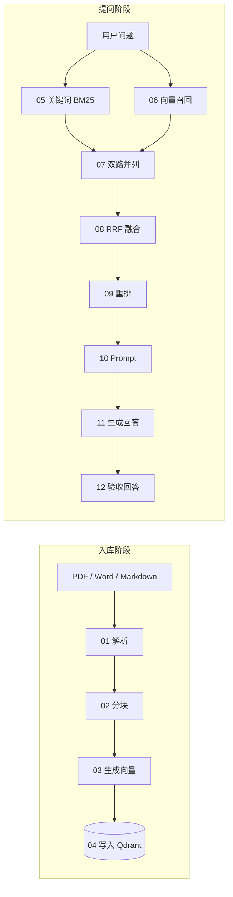

# RAG 教程：从文档到可追溯的答案

面向第一次接触 RAG 的产品、业务和开发同事。建议 45–60 分钟：沿流水线走 12 个停靠点，先看资料怎样入库，再看一个问题怎样找到资料并形成回答。

本教程有三种入口：浏览器教学实验室（12 站逐步演示）、八个独立 PowerShell demo，以及逐节讲义。解析、分块、向量存取、RRF 融合、Prompt 组装复用当前项目代码；本教程不操作 NX。

## 启动与授课

```powershell
# 项目根目录；需 JDK 17、Maven，模型配置沿用忽略文件 .local.env
.\scripts\Start-Local.ps1
# 代码更新前已经运行应用时，先仅停应用，再构建启动；Qdrant 和 NX 不需要停止
# .\scripts\Stop-Local.ps1 -AppOnly
# .\scripts\Start-Local.ps1
```

打开 [RAG 教学实验室](http://127.0.0.1:8090/tutorial.html)，或者从首页左侧进入。点击“准备示例”，从第 01 站开始用“下一步”逐站推进；每站左侧是讲解（为什么、看哪里、试试看、常见错误），右侧是这一站的真实输入与输出。也可以点击“运行整条链路”。不要把真实敏感文档用于公开授课。

页面还提供 **100 份公开员工手册**：选择机构、查看原始来源、指定连续 1–3 个物理页进入 12 站实验，也能直接向完整手册提问。完整文件全部经过正式入库；页面选页只缩小教学展示范围。[数据来源、下载/入库/评测命令及 9 道问题](../evals/handbooks/README.md)。

Start-Local 会启用本地教学 API；其他启动方式需要 `RAG_TUTORIAL_ENABLED=true`，默认关闭。API 沿用服务 Bearer 鉴权，实验归属通过会话 cookie 绑定；页面沿用首页连接设置中的服务令牌。



第 04 站与第 12 站不产生新数据：它们分别复核第 03 站写入的 Qdrant 记录、第 11 站回答的引用与数字，因此不重复调用模型。

## 一节课的安排

| 时间 | 停靠点 | 让听众观察的东西 |
|---|---|---|
| 0–5 分钟 | 展示原始手册与问题 | “上海酒店每晚最高能报销多少钱？”的依据在哪一段 |
| 5–10 分钟 | [01 文档解析](01-parsing.md) | PDF 物理页码、Word 章节、表格被拍平后的样子 |
| 10–15 分钟 | [02 分块](02-chunking.md) | 220/40 与 800/120 的片段数量、可见重叠 |
| 15–20 分钟 | [03 生成向量](03-embedding-store.md) | 实际维度、L2 范数、前八维没有业务含义 |
| 20–23 分钟 | 04 写入 Qdrant | pointsCount 是否等于片段数；collection 带配置签名 |
| 23–28 分钟 | [04 关键词召回](04-vector-recall.md) | BM25 分数无固定区间；生造词直接返回空 |
| 28–33 分钟 | 06 向量召回 | Cosine 分数、本地复算、阈值只作用于这一路 |
| 33–37 分钟 | 07 双路并列 | 两路的第一名是否同一个片段、名次差多少 |
| 37–42 分钟 | [05 RRF 融合](05-fusion.md) | 每路名次与 1/(60+rank) 贡献，手算对照 |
| 42–47 分钟 | [06 重排](06-reranking.md) | 重排前后名次、原始相关性分数、分数不可比 |
| 47–51 分钟 | [07 Prompt 组装](07-prompt.md) | system/user 分区、[n] 编号、字符数随证据增长 |
| 51–56 分钟 | [08 生成与引用](08-generation.md) | 回答里的数字、城市、类别是否对得上原文 |
| 56–60 分钟 | 12 验收回答 | 程序能查出什么、哪些必须人工核对 |

## 八个独立 demo

从项目根目录执行。每次创建自己的实验，输出所有实际输入/输出到 `.runtime/tutorial/run-*/`，最后清理实验 collection。日志显示具体目录，`manifest.json` 记录完成步骤与清理状态。

```powershell
.\tutorial\demos\01-parse.ps1 -Sample docx
.\tutorial\demos\02-chunk.ps1 -Size 220 -Overlap 40
.\tutorial\demos\03-embedding-store.ps1
.\tutorial\demos\04-vector-recall.ps1 -Query '去上海出差，酒店每晚最高能报销多少钱？'
.\tutorial\demos\05-fusion.ps1
.\tutorial\demos\06-rerank.ps1 -RerankMethod configured
.\tutorial\demos\07-prompt.ps1
.\tutorial\demos\08-generate.ps1
# 完整串联；这一条才用真实召回结果作为重排输入
.\scripts\Invoke-RagTutorial.ps1 -Stage all
# 可复现验收；不联网调用模型的对照可加 -Offline
.\scripts\Test-RagTutorial.ps1
```

01、02 不调用模型；07 使用独立证据集展示 Prompt。03、04、05 自动运行必要的前置步骤；05 的融合来自两路实际召回。独立 06 使用固定虚构候选集对照排序；完整链路的 06 使用 05 的融合结果。08 的独立 demo 先组装证据再调用模型。

关键词召回可用 `Invoke-RagTutorial.ps1 -Stage retrieve -RecallMode keyword`；离线融合可用 `05-fusion.ps1 -RecallMode keyword`（只有一路贡献）。无需模型的离线课还可以执行 01、02、07，以及 `06-rerank.ps1 -RerankMethod bm25`。BM25 是关键词对照，不是神经网络重排；没有提供假的 Embedding 或假的模型答案来代替云端结果。

## 模型与重排的真实含义

当前本机 Embedding 是智谱 `embedding-3` / 2048 维，聊天是 DeepSeek。新同事必须在自己的 `.local.env` 配置密钥，仓库不会包含凭据。

重排提供三种选择：

- `llm`：实际调用配置的聊天模型，将完整候选排列输出为 JSON，校验序号完整、不重复、不越界。属于 LLM listwise 重排，不是 Cross-Encoder；没有相关性概率分数。
- `bm25`：本地 Lucene 中文 BM25，仅对候选重新计算关键词分数，用于离线对照。
- `configured`：调用生产代码 `Reranker`。`RAG_RERANK_MODE=http` 使用 Cohere 兼容 HTTP 合同，需配置 `RAG_RERANK_URL/API_KEY/MODEL`；`llm` 使用现有聊天模型选择 Top-K 候选。本机现已配置智谱 `rerank` HTTP 服务；此前 LLM 验收记录保留为历史快照。配置见 [智谱重排](../docs/GLM_RERANK.md)。

## 授课实验与观察问题

1. 用相同手册比较 Markdown、Word 和两页 PDF。PDF 示例为英文，是文本解析示例，不是中文 OCR；Word 示例额外包含汇总表。
2. 将分块从 220/40 调到 800/120。注意变更会使后续入库、召回和回答结果失效，需要重新运行。
3. 将“上海住宿上限”改为“去上海出差，酒店每晚最高能报销多少钱？”。观察语义检索；同一问题修改阈值时会复用本轮问题向量。
4. 将阈值提高到 0.99：只会过滤向量一路。继续融合可观察关键词贡献；仅向量模式为空时，融合会要求先召回非空候选。
5. 重排选择独立候选集。比较上海办公室会议餐饮 80 元、北京住宿 550 元、上海住宿 650 元，观察模型能否区分范围；排序不变也是有效结果。
6. 使用独立 Prompt demo，观察系统规则如何把文档放在数据区。提示词约束不是提示注入攻击的完整安全保证。
7. 提问资料没有覆盖的事情，例如公司 CEO 的手机号。模型应该说明无法依据资料确认；不要把“召回到了片段”当作“片段能回答问题”。

## 实验隔离与限制

- 每个教学实验独立 collection，前缀 `rag_tutorial_`；不修改公司索引，不调用 NX。公开手册的完整文件由导入脚本另行上传正式知识库，完整手册问答走生产检索 API。
- 最多 8 个实验、2 个并发步骤、24 个片段；直接教学上传上限 2 MiB。已正式入库的 PDF 可复用原文件（正式上传上限 20 MiB），选取连续 1–3 页；展示文字仍限 20000 字符，实验 30 分钟过期。
- 改变解析/分块会清理旧实验向量并使后续结果失效；改变问题后必须重新召回/重排。
- API 仅接受样例类型或上传文件，不接受服务端任意路径、模型 URL 或 Qdrant collection 名称。
- 点击“清理实验”或脚本结束时删除本次 collection。浏览器关闭不等于清理，服务运行时会定时清理过期实验。重启会丢失内存中的实验状态；重启前未清理的教学 collection 可能保留，需维护人员按记录的名称清理，不能删除公司 collection。
- 原文件、向量和日志在本地；Embedding 收到片段与问题，重排 API 收到问题与候选，生成模型收到完整 Prompt。调用会产生供应商费用。
- 生产问答原本采用 BM25 + 向量 + RRF，本教程 04 已分别展示 BM25 与向量召回。教程没有声称已完成企业召回率评测。

## 输出与源码

[实测输入/输出快照](outputs/README.md) 记录本次实际运行结果；同事重新运行时应以自己的输出为准。模型浮点值、顺序和措辞可能变化，快照不是测试期待模型精确复述的答案。

后端位于 `java-chatbot/src/main/java/chatbot/chat/rag/tutorial/`；网页是 `static/tutorial.html/js/css`；原始中文资料是 `resources/tutorial/company-travel.md`。原理与代码映射见各节讲义，接口见 [API 文档](../docs/API.md)。

## 原理参考

- [Spring AI ETL](https://docs.spring.io/spring-ai/reference/api/etl-pipeline.html)：Reader、Transformer、Writer 的职责划分。
- [Qdrant Search](https://qdrant.tech/documentation/search/search/)：向量距离、召回与阈值。
- [Cohere Rerank](https://docs.cohere.com/docs/rerank-overview)：对已有候选进行重排序。
- [LLM 重排研究](https://arxiv.org/abs/2304.09542)：使用语言模型作为重排器的研究依据。
